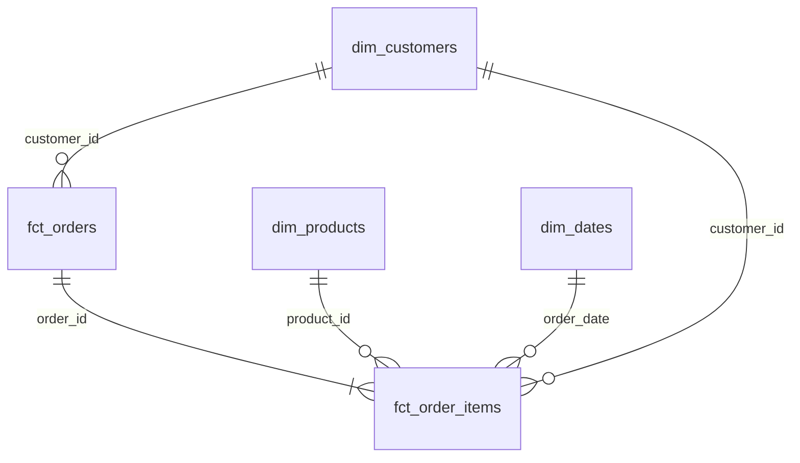
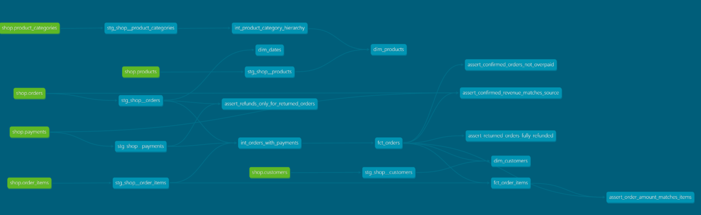

# store_hse

## ER-диаграмма

### Описание аналитических витрин

| Витрина | Тип | Зернистость | Бизнес-вопрос |
|---|---|---|---|
| fct_orders | Факт | Один заказ | Каковы количество, стоимость и статус заказов? Сколько денег получено и возвращено? |
| fct_order_items | Факт | Один товар в заказе | Какие товары покупают, в каком количестве и какую выручку они приносят? |
| dim_customers | Измерение | Один клиент | Какова доля покупателей по каналам привлечения? Сколько выручки приносят клиенты? |
| dim_products | Измерение | Один товар | Какие товары, бренды и категории наиболее востребованы? |
| dim_dates | Измерение | Один календарный день | Как изменяются продажи по месяцам, кварталам, дням недели и выходным? |

### Хранение в Greenplum

| Витрина | Распределение | Почему |
|---|---|---|
| fct_orders | DISTRIBUTED BY (order_id) | Фактовая таблица распределяется по идентификатору заказа. Это позволяет эффективно соединять её с позициями заказов по order_id. |
| fct_order_items | DISTRIBUTED BY (order_id)  | Используется тот же ключ распределения, что и в fct_orders. Это позволяет выполнять соединение двух фактов локально, без пересылки строк между сегментами. |
| dim_customers | DISTRIBUTED REPLICATED | Небольшое измерение (40 строк). Полная копия на каждом сегменте позволяет соединять его с фактами без пересылки строк измерения. |
| dim_products | DISTRIBUTED REPLICATED | Небольшое измерение (13 строк). Репликация обеспечивает доступность всех товаров на каждом сегменте при соединениях. |
| dim_dates | DISTRIBUTED REPLICATED | Небольшое календарное измерение (133 строки). Репликация позволяет выполнять соединения с фактовыми таблицами без перераспределения данных измерения. |

### Граф зависимостей dbt

